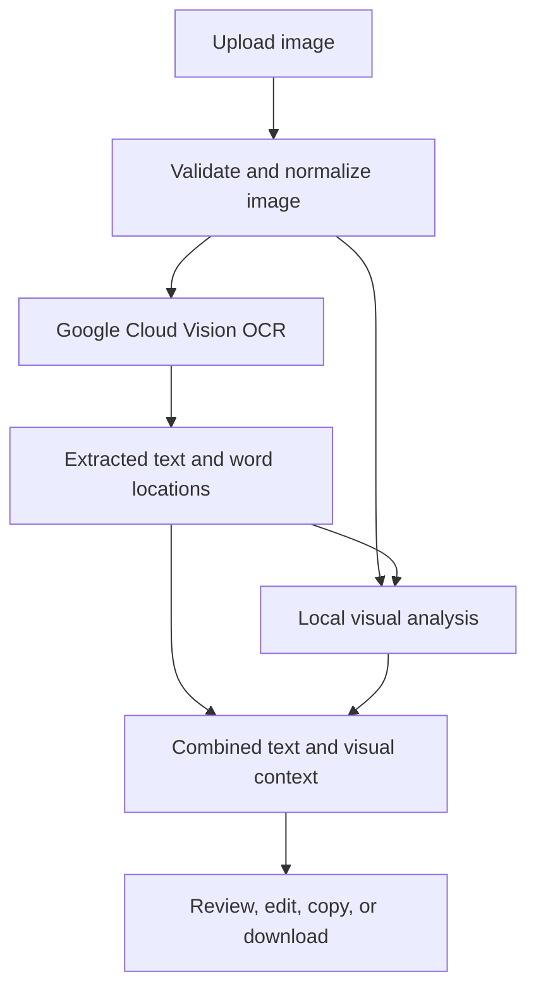

# Typeframe

### Turn image text and visual structure into context you can share with AI.

Typeframe extracts text from images and adds the visual information around it: layout, grouping, colours, contrast, and candidate connections. It is designed for workflows, diagrams, and code screenshots.

Upload an image, review the results, and copy a combined representation into another AI conversation or download it as JSON.

## Why this project exists

Image upload limits can interrupt an AI conversation. Copying the text out of an image helps, but loses information such as which labels belong together, where arrows point, and which lines are highlighted.

Typeframe explores a practical alternative: combine OCR text with a structured description of the image's visible layout. This gives another AI more context than plain transcription alone.

The output is an approximation of observed content, not a lossless replacement for the original image. Its usefulness depends on extraction accuracy, image complexity, and the receiving AI's capabilities and text limits.

## Features

### Text extraction

- Extracts detected text using Google Cloud Vision's document text detection.
- Retains OCR word locations and confidence values for visual analysis.
- Supports editing, copying, and downloading the extracted text.

### Visual context

- Detects candidate containers and nested regions.
- Associates OCR words with their containing regions.
- Records positions, relative rows and columns, background colours, and a sampled colour palette.
- Captures heading bands and sampled text/background contrast.
- Locates candidate non-text graphics within containers without guessing their identities.

### Workflow mode

- Detects candidate connectors between supported containers.
- Records connector paths and arrow direction when there is sufficient visual evidence.
- Keeps unclear directions marked as unknown.

### Code screenshot mode

- Groups OCR words into visual lines.
- Estimates relative indentation from text positions.
- Records alignment without claiming to recover the original tabs or spaces.

### Review and export

- **Text:** inspect and edit the transcription.
- **Visual context:** read the summary and review detected regions and connectors on the image.
- **Structured data:** inspect and download the combined JSON.
- **Copy for AI:** copy text, visual observations, and uncertainty information together.

Text edits are included in exports. OCR references and geometry continue to describe the original image, and exports include a note when the transcription has been edited.

## How it works



Google Cloud Vision handles OCR. Pillow, NumPy, and OpenCV perform local image processing on the application server. The readable visual summary is generated from those observations.

The current implementation uses geometric heuristics for visual analysis. It does not require a separately hosted vision-language model or an additional generative-AI API key.

## Technology stack

| Layer | Technologies |
| --- | --- |
| Frontend | React, Vite, CSS |
| Backend | Python, FastAPI, Uvicorn |
| OCR | Google Cloud Vision |
| Visual analysis | OpenCV, Pillow, NumPy |
| Testing | Python `unittest`, synthetic images, mocked Google responses |
| Packaging | Docker with a frontend build stage |

## Project structure

```text
ocr/
├── app.py                       # Upload API and frontend serving
├── main.py                      # Standalone OCR script
├── visual_context.py            # Image validation and visual analysis
├── requirements.txt
├── Dockerfile
├── .dockerignore
├── .gitignore
├── frontend/
│   ├── index.html
│   ├── package.json
│   ├── package-lock.json
│   ├── vite.config.js
│   └── src/
│       ├── App.jsx
│       ├── VisualContext.jsx
│       ├── main.jsx
│       └── styles.css
└── tests/
    ├── test_api.py
    └── test_visual_context.py
```

## Getting started

### Prerequisites

- Python 3.11 or later.
- Node.js and npm; the Docker build uses Node.js 22.
- A Google Cloud project with the Vision API enabled and appropriate service access.
- Google Cloud Application Default Credentials available to the backend.

The commands below use Windows PowerShell.

### 1. Clone the repository

```powershell
git clone https://github.com/shivamkm55/ocr.git
cd ocr
```

### 2. Set up Python dependencies

```powershell
python -m venv .venv
.\.venv\Scripts\python.exe -m pip install -r requirements.txt
```

If an environment already exists, use it instead of creating another one.

### 3. Configure Google authentication

For local development with the Google Cloud CLI:

```powershell
gcloud auth application-default login
```

Use an account and project configured to access the Vision API. See Google's [local Application Default Credentials setup guide](https://docs.cloud.google.com/docs/authentication/set-up-adc-local-dev-environment) for project-specific authentication requirements.

Credentials belong in the backend environment, not in the frontend or Git repository. Google Cloud Vision usage is subject to the service's normal billing and quotas.

### 4. Start the backend

From the repository root:

```powershell
.\.venv\Scripts\python.exe -m uvicorn app:app --reload --port 8000
```

API documentation is available at [http://localhost:8000/docs](http://localhost:8000/docs).

### 5. Start the frontend

Open a second terminal:

```powershell
cd frontend
npm ci
npm run dev
```

Open the address printed by Vite, normally [http://localhost:5173](http://localhost:5173). The development server forwards `/ocr` requests to the backend on port 8000.

## Using Typeframe

1. Upload a PNG, JPEG, or WebP image.
2. Enable **Include visual context** to request layout analysis alongside OCR.
3. Select **Workflow** or **Code screenshot**.
4. Click **Extract text + context**.
5. Review the transcription, region overlays, candidate connections, and uncertainties.
6. Correct the text if needed.
7. Use **Copy for AI**, **Save .txt**, or **Save .json**.

For text extraction alone, disable **Include visual context**.

## API

### `POST /ocr`

Accepts a multipart form:

| Field | Type | Default | Purpose |
| --- | --- | --- | --- |
| `file` | Image file | Required | JPEG, PNG, or WebP still image |
| `include_context` | Boolean | `false` | Adds local visual analysis |
| `context_mode` | `workflow` or `code` | `workflow` | Selects the analysis mode |

Example request from PowerShell:

```powershell
curl.exe -X POST "http://localhost:8000/ocr" -F "file=@workflow.png" -F "include_context=true" -F "context_mode=workflow"
```

Replace `workflow.png` with the path to your image. For an authenticated deployment, use its configured authentication mechanism as well.

Every successful OCR response retains these fields:

```json
{
  "filename": "example.png",
  "text": "Extracted image text",
  "characters": 20
}
```

*This is an illustrative text-only response.*

When requested, `visual_context` adds:

| Field | Contents |
| --- | --- |
| `image`, `coordinate_system` | Normalized image dimensions and coordinate conventions |
| `text_regions` | OCR word IDs, text, confidence, polygons, and bounds |
| `background`, `palette` | Sampled background and colour information |
| `regions` | Candidate containers, nesting, colours, appearance bands, and OCR associations |
| `connections` | Candidate connector paths, endpoints, directions, and heuristic scores |
| `emphasis` | Sampled text colours, backgrounds, and estimated contrast |
| `graphics` | Bounds of candidate non-text graphics |
| `code_layout` | Estimated line grouping and indentation in code mode |
| `summary` | Readable explanation of the observations |
| `uncertainties` | Limits and unresolved details |

Coordinates refer to the original-size image after orientation normalization. Bounding boxes use `[left, top, right, bottom]`, with the origin at the top left.

If visual analysis fails after successful OCR, the response still contains the extracted text and an explicit `context_error`.

## Build and deployment

Build the frontend:

```powershell
cd frontend
npm ci
npm run build
```

Once `frontend/dist` exists, the FastAPI backend serves the compiled interface from `/` and its generated assets from `/assets`.

If Vite's configuration bundler encounters an ancestor-directory access error on a restricted Windows environment, use:

```powershell
npm run build -- --configLoader runner
```

Build the container from the repository root:

```powershell
docker build -t typeframe .
```

The Dockerfile builds the frontend and includes it in the Python image. The server uses the `PORT` environment variable, defaulting to `8080`. Configure Google credentials and service permissions for the runtime environment. A new build and deployment are needed to update an already hosted version.

## Tests

Run from the repository root:

```powershell
.\.venv\Scripts\python.exe -m unittest discover -s tests -v
```

The tests use synthetic images and mocked Google responses. They do not need cloud credentials or make live Vision API calls.

Coverage includes:

- Upload validation and actual multipart form parsing.
- Compatibility with existing text-only responses.
- Preserving OCR results when visual analysis fails.
- Container detection, nesting, text grouping, and colour sampling.
- Decision diamonds and heading separators.
- Directed arrows, undirected lines, and bent connectors near unrelated regions.
- Code line order and relative indentation.
- Orientation, transparency, size limits, and original-coordinate exports.

## Supported inputs and limits

| Constraint | Limit |
| --- | --- |
| Formats | JPEG, PNG, WebP |
| Upload size | 10 MB |
| Decoded image size | 20 megapixels |
| Maximum side | 10,000 pixels |
| Animation | Still images only |
| Local geometry analysis | Maximum 1,400-pixel side, mapped back to original coordinates |
| OCR word locations used for context | First 8,000 words |
| Candidate containers | Up to 60 |

The backend also rejects normalized images that exceed its OCR processing payload limit. Transparency is composited on white, and image orientation is normalized before both processing passes.

## Current limitations

- Visual analysis is geometry-based and works best with clear workflows, diagrams, and code screenshots.
- OCR can misread small lettering, stylized logos, or low-quality text.
- Curved, dashed, crossing, faint, or overlapping connectors can be missed or remain ambiguous.
- Connector labels and branch meanings are not assigned automatically.
- Colours describe observed appearance; success, failure, or importance is not inferred from colour alone.
- Graphic candidates have locations, but their icon or logo identities are unresolved.
- Contrast and indentation are estimates. Code is not executed or semantically validated.
- Connector scores are uncalibrated geometric heuristics, not probabilities of correctness.

Review the image overlay and uncertainty information before relying on the exported structure. Structured data makes observations portable and inspectable; it does not make every observation correct.
